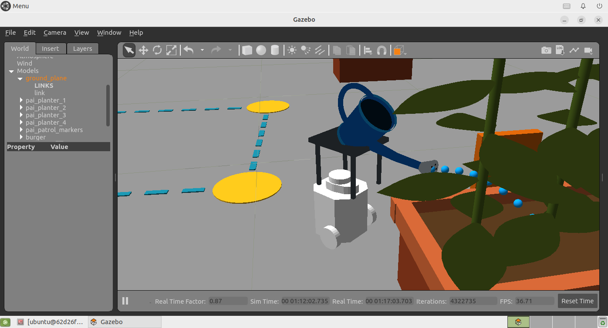

# 植物の状態に応じて水やりする自律巡回ロボット

Physical AI応用1 最終課題 / omnicampus: **nobima123**

ROS 2 Humble・Gazebo Classic上のTurtleBot3 Burgerが4個のプランターを巡回します。
土と葉の模擬センサー値から学習済みニューラルネットが目標量を推定し、じょうろの測定角度と仮想流量の積算から給水量を調整します。次の巡回は更新後の状態を使います。



## 実装したもの

- 位置フィードバックによる1m四方・4地点の固定ルート巡回。
- 土壌水分、葉のしおれ度、気温、湿度の4入力による給水量の学習済み推定。
- 鉢への低速接近、静止給水、直立復帰、巡回経路への復帰。
- Gazeboの関節位置を読むC++プラグインとPythonの給水量制御。
- 植物状態の更新、土・葉・札・説明用水滴の表示、2周目の再判断。
- センサー途絶・停止要求への対処とJSONL/CSVの記録。

**土と葉は模擬値です。画像認識や実センサー観測は行いません。**
角度はGazebo関節の測定値、流量・mL・植物回復は教材用の仮想モデルです。
水滴は説明用描画であり、流体衝突は計算していません。実植物に対する水量の妥当性は未評価です。

## 対象環境

Windows PowerShellから既存Dockerコンテナ `pai_ros2` を操作します。

- イメージ: `airobotbook/ros2-desktop-ai-robot-book-humble:latest`（講座環境）。
- ROS 2 Humble / Gazebo Classic 11 / Ubuntu 22.04。
- TurtleBot3 Burgerと`empty_world.launch.py`を使用。
- 作業先: `/home/ubuntu/pai_final_project`。
- 必要な開発環境: CMake、g++、Gazebo開発ライブラリ、gazebo_ros、rclcpp、std_msgs、sensor_msgs、protobuf、TBB。
- Python実行時: rclpy、gazebo_msgs、geometry_msgs、nav_msgs、sensor_msgs、std_msgs、std_srvs。
- 再学習: NumPy。グラフ出力のみMatplotlib。録画のみFFmpeg・X11・Noto CJK・MATEデスクトップ。

本コードは上記の講座コンテナで検証しました。汎用ROSディストリビューションへの自動導入は実装していません。
特にインストーラは次の既存モデルを読みます。

```text
/home/ubuntu/airobot_ws/install/turtlebot3_gazebo/share/turtlebot3_gazebo/models/turtlebot3_burger/model.sdf
```

## セットアップと実行

既存作業がある場合は、先にそのフォルダを別名で保存してください。
配布フォルダ内でPowerShellを開いて以下を実行します。

```powershell
docker start pai_ros2
docker exec -u ubuntu pai_ros2 mkdir -p /home/ubuntu/pai_final_project
docker cp ./. pai_ros2:/home/ubuntu/pai_final_project
docker exec -u root pai_ros2 chown -R ubuntu:ubuntu /home/ubuntu/pai_final_project
```

標準のシミュレーションがまだ動いていない場合のみ、別のPowerShellで起動します。既存Gazeboがある場合は二重起動しません。

```powershell
docker exec -it -u ubuntu pai_ros2 bash -lc 'source /opt/ros/humble/setup.bash && source /home/ubuntu/airobot_ws/install/setup.bash && export TURTLEBOT3_MODEL=burger && ros2 launch turtlebot3_gazebo empty_world.launch.py'
```

ネイティブプラグインをビルドします。

```powershell
docker exec -u ubuntu pai_ros2 bash -lc 'source /opt/ros/humble/setup.bash && cmake -S /home/ubuntu/pai_final_project/precision_plugin -B /home/ubuntu/pai_final_project/precision_plugin/build -DCMAKE_BUILD_TYPE=Release && cmake --build /home/ubuntu/pai_final_project/precision_plugin/build -j2'
```

乾いた初期状態に戻し、2周します。

```powershell
docker exec -it -u ubuntu pai_ros2 bash -lc 'source /opt/ros/humble/setup.bash && python3 /home/ubuntu/pai_final_project/run_precision_demo.py --reset-plants --laps 2'
```

初回は現在のロボット位置に合わせて植物と経路を作成します。初期状態では鉢1・3へ給水し、鉢2・4は見送ります。2周目は更新した値から全4鉢を見送ります。PC負荷・開始位置で所要時間は変動します。

`--reset-plants`は模擬植物と仮想タンクを初期化し、実行中の`burger`を関節付きコピーから再生成します。**元の標準モデルSDFは変更しません。** ほかの走行・遠隔操作ノードを停止してから実行してください。

停止は別のPowerShellから実行します。

```powershell
docker exec -u ubuntu pai_ros2 bash -lc 'source /opt/ros/humble/setup.bash && ros2 service call /pai_patrol/stop std_srvs/srv/Trigger {}'
```

## AIの学習と評価

人工教師式から1,700件を生成し、学習1,200・検証200・最終評価300件に分割しました。
モデルは入力4、ReLU隠れ層16、出力1の回帰です。実行時は保存した重みから推論します。

```text
人工の目標量 = clip(4*(55-土壌水分) + 0.45*しおれ度
                   + 0.6*(気温-25) - 0.1*(湿度-50), 0, 180)
```

土壌水分55以上、または予測量5仮想mL未満は見送り、上限は180仮想mLです。
土壌水分・しおれ度は0〜100の模擬尺度で、実際の体積含水率ではありません。
最終評価のMAE 0.0163仮想mLは**人工式の再現誤差**であり、農学上の必要水量の精度ではありません。
AIが単純なルールより優れていることを比較実験で示したものではありません。

```powershell
docker exec -u ubuntu pai_ros2 bash -lc 'cd /home/ubuntu/pai_final_project && python3 train_dose_model.py'
```

再学習は`ai_model/dose_model.json`等を上書きします。配布重みのまま実行する場合は不要です。

## 角度と仮想流量

```text
仮想流量[mL/Sim秒] = 1.2 * max(測定角度[度]-20, 0) * sqrt(仮想残量/750)
```

流量をGazebo時間で積分します。制御側は目標と積算量の差で次の角度を調整し、最大50度、終了時は直立を指示します。直立へ戻る間の流出も計上します。許容差は±5仮想mLです。
4仮想mLで土壌水分を1ポイント増やし、2仮想mLでしおれ度を1ポイント減らす簡易モデルです。

## 試験

```powershell
docker exec -u ubuntu pai_ros2 bash -lc 'source /opt/ros/humble/setup.bash && cd /home/ubuntu/pai_final_project && python3 -m unittest -v test_patrol test_watering_ai test_precision'
docker exec -u ubuntu pai_ros2 bash -lc 'source /opt/ros/humble/setup.bash && python3 /home/ubuntu/pai_final_project/verify_precision_demo.py --laps 2'
```

16件のユニットテスト、Gazeboの1周・2周・給水中停止を確認しました。
提出動画の2周試験は日本時間2026年10月27日に収録しました。UTCの記録名は`precision_20261026T221459Z`です。
初期化を含む192.77秒で完了し、鉢1は180.00に対して180.158、鉢3は152.20に対して152.651仮想mLでした。2周目は全4鉢を見送りました。
公開用コードのコピーから16件のテストを実行し、C++の再ビルドも確認しています。

以下はそれ以前の別の試験記録です。
2026年10月26日の1周試験は141.36秒で完了し、鉢1は180.00に対して180.092、鉢3は152.20に対して152.579仮想mLでした。
2周試験では1周目の2鉢給水後、2周目は全4鉢を見送りました。
途中停止試験では測定角度29.72度から0.0049度へ復帰し、仮想流量0を確認しました。
記録は`evidence/`に含めています。各数値は個別の試験の結果です。

## ファイル構成とトピック

| ファイル | 役割 |
|---|---|
| `run_precision_demo.py` | 起動・初期化・終了処理 |
| `patrol.py` | 位置フィードバック、停止、巡回状態遷移 |
| `precision_plants.py` | 模擬植物状態と給水結果の反映 |
| `dose_model.py` / `train_dose_model.py` | 給水量の推論 / 再学習 |
| `precision_watering.py` | 接近・給水・復帰、目標量の制御 |
| `precision_plugin/` | 関節制御とGazebo描画のC++ソース |
| `setup_plant_scene.py` / `attach_watering_can.py` | 植物・じょうろ形状の生成 |
| `verify_precision_demo.py` | 別ノードから実測値を観測して検証 |

主なトピック：`/odom`、`/scan`、`/cmd_vel`、`/pai_plants/state`、`/pai_watering/decision`、`/pai_watering/tilt_cmd`、`/pai_watering/joint_states`、`/pai_watering/can_state`。
旧`--watering-demo`は過去段階の要否判断モードです。提出対象の動作は`run_precision_demo.py`で起動します。

## 制限

固定経路です。SLAM、経路計画、実カメラ認識、実土壌計測、実水量の測定、流体衝突、植物生理・病気の診断は対象外です。
実物障害物を置く試験は未実施です。実機や実植物への導入には別の設計・校正・評価が必要です。

## 既存機能と出典

ROS 2、Gazebo、TurtleBot3の既存機能を基盤に使い、巡回・給水量推定・関節制御・状態更新・記録を追加しました。
標準TurtleBot3モデル、既存パッケージ、ビルド済みライブラリ、個人のバックアップや認証情報は配布しません。
講座のロボット操作サンプルは設計検討の参考です。使用した外部パッケージのライセンスはそれぞれの配布元に従います。
詳しくは`THIRD_PARTY_NOTICES.md`を参照してください。
